# نظام إدارة أعمال بوكر فارما — وثيقة قواعد العمل وتصميم قاعدة البيانات (المرحلة 1 و 2)

**تاريخ الإعداد:** 2026-10-23  
**النسخة:** MVP v0.1  
**الجهة:** شركة بوكر فارما للتجارة والاستثمار المحدودة (توزيع الأدوية والمستلزمات الطبية)

---

## 1. ملخص المرحلة الأولى: قواعد العمل وهندسة النظام (Business Rules & Architecture)

### 1.1 طبيعة النظام وبيئة العمل
تطبيق ويب متكامل لإدارة تجارة وتوزيع الأدوية والمستلزمات الطبية في السودان. يعمل النظام وفق أعلى معايير التوزيع الصيدلاني الجيد (**Good Distribution Practice - GDP**)، مع ضبط دقيق لتواريخ الصلاحية، وأرقام التشغيلات، وحركات المخازن، والذمم المالية للعملاء (صيدليات ومستشفيات) والموردين، والصناديق النقدية والبنوك المحلية (مثل تطبيق بنكك / فوري).

---

### 1.2 قواعد العمل الأساسية (Business Rules)

#### أ. الأصناف والأدوية (Products & Categories)
1. **التعريف المزدوج**: لكل صنف اسم تجاري (Trade Name) واسم علمي (Generic Name)، والشركة المصنعة، وبلد المنشأ، والفئة الدوائية، والجرعة/الشكل الصيدلاني (أقراص، كبسول، شراب، حقن...).
2. **الباركود والرمز**: كود فريد لكل صنف، مع دعم الباركود الدولي أو المحلي للبحث السريع.
3. **حماية الأسعار**:
   - سعر الشراء الافتراضي، سعر البيع المعتمد.
   - حد أدنى لسعر البيع (`min_selling_price`) لا يجوز لمسؤول المبيعات تجاوزه نزولاً لمنع الخسائر دون صلاحية خاصة.
4. **حد إعادة الطلب (`min_stock_alert`)**: إشعار تلقائي في لوحة التحكم عند وصول الرصيد الإجمالي للصنف إلى هذا الحد.

#### ب. التشغيلات والصلاحية (Batches & Expiry Management)
1. **إلزامية التشغيلة (Batch Mandatory)**: لا يمكن شراء أو تخزين أو بيع أي صنف دوائي دون تحديد رقم التشغيلة (`batch_number`) وتاريخ الصلاحية (`expiry_date`).
2. **حظر بيع المنتهي مطلقاً**: يمنع النظام منعاً باتاً من خلال قاعدة تحقق برمجية وقاعدة بيانات (Database Constraint & Service Check) إدراج أو تأكيد أي تشغيلة تاريخ صلاحيتها أقل من أو يساوي تاريخ اليوم في فواتير البيع.
3. **تنبيهات الصلاحية**:
   - **منتهي (Expired)**: تاريخه اليوم أو سابق (محظور من البيع آلياً ويُتاح تحويله لمخزن العزل والتالف).
   - **قريب الانتهاء (Near Expiry)**: الصلاحية المتبقية أقل من 180 يوماً (أو حد زمني يتم ضبطه بالإعدادات).
   - **سليم (Valid)**: أكثر من 180 يوماً.
4. **سياسة صرف المخزون (Dispatch Policy)**:
   - **FEFO (First Expire, First Out - الأقرب انتهاءً يخرج أولاً)**: الخيار الافتراضي والموصى به صيدلانياً.
   - **FIFO (First In, First Out - الأقدم وروداً يخرج أولاً)**: متاح كبديل قابل للتبديل من الإعدادات العامة بنقرة زر (`dispatch_policy = 'FEFO' | 'FIFO'`).

#### ج. المخازن وإدارة الأرصدة (Warehouses & Stock)
1. **تعدد المخازن**: دعم مخازن متعددة (المخزن الرئيسي، مخزن التبريد/الثلاجة، مخزن المستلزمات، ومخزن العزل/التالف).
2. **منع الأرصدة السالبة**: لا يسمح النظام بخروج كمية تفوق الرصيد الفعلي المتوفر للتشغيلة في المخزن المحدد.
3. **سجل حركة المخزون غير القابل للتعديل (`stock_transactions`)**: كل وارد أو منصرف أو تحويل أو تسوية جرد يُسجل كحركة مالية ومخزنية مع الكمية قبل والكمية بعد والمستخدم والوقت.

#### د. المشتريات والموردين (Purchases & Suppliers)
1. استلام فاتورة الشراء يتطلب إدخال رقم التشغيلة وتاريخ الإنتاج والانتهاء لكل بند.
2. عند اعتماد الفاتورة: زيادة رصيد المخزن للتشغيلة، وتحديث رصيد المورد (دائن) أو السداد من الصندوق/البنك.

#### هـ. المبيعات والعملاء (Sales & Customers)
1. فحص فوري لتوفر المخزون والصلاحية.
2. فحص الحد الائتماني للعميل (`credit_limit`): في حال البيع الآجل، إذا كان رصيد العميل + الفاتورة الحالية يتجاوز الحد، يُمنع الإصدار إلا بموافقة المدير (`manager` أو `admin`).
3. عند التأكيد: خصم فوري للمخزون، تسجيل حركة المخزون، وتحديث رصيد العميل (مدين) أو إيداع النقدية في الصندوق/البنك.

#### و. المرتجعات (Returns)
1. **مرتجع المبيعات**: إعادة أدوية صالحة تعود للمخزن الصالح، أو أدوية تالفة تعود لمخزن العزل (`quarantine`)، مع خصم قيمتها من مديونية العميل أو رد النقدية.
2. **مرتجع المشتريات**: خصم من المخزن وتخفيض حساب المورد.

#### ز. الحسابات والمالية (Treasury & Cash Flow)
1. إدارة الخزائن النقدية والحسابات البنكية (مثل بنكك).
2. سندات القبض (تحصيل من عميل)، سندات الصرف (سداد مورد أو مصروفات تشغيلية)، وسندات التحويل بين الصناديق.
3. كشف حساب تفصيلي (مدين، دائن، رصيد تراكمي) للعملاء والموردين.

#### ح. التدقيق والأمان والصلاحيات (Security & Audit Log)
1. تشفير كلمات المرور باستخدام `password_hash(PASSWORD_BCRYPT)`.
2. حماية كاملة من ثغرات SQL Injection عبر PDO Prepared Statements، وحماية XSS عبر sanitization، وحماية CSRF عبر Tokens.
3. تسجيل كل العمليات الحساسة في `audit_logs` متضمناً القيمة السابقة والجديدة بصيغة JSON.

---

### 1.3 التصميم المعماري (Architecture Overview)

```
+--------------------------------------------------------------------------+
|                  Frontend Layer (HTML5, CSS3, JS ES6+, Bootstrap RTL)    |
|   - Fully Decoupled SPA/PWA ready                                        |
|   - Communicates exclusively via REST API using JSON                     |
|   - Portable to Electron Desktop App with zero backend rewrite           |
+--------------------------------------------------------------------------+
                                    | (JSON over HTTP/Fetch)
                                    v
+--------------------------------------------------------------------------+
|                  Backend API & Routing (PHP 8.x MVC Core)                |
|   - Router & Middleware (Auth, CSRF, Role-Permission RBAC)               |
|   - Controllers (Input Validation, DTOs, JSON Responses)                 |
+--------------------------------------------------------------------------+
                                    |
                                    v
+--------------------------------------------------------------------------+
|                         Business Services Layer                          |
|   - AuthService, SalesService, PurchaseService, InventoryService,        |
|     ExpiryDispatchService, AccountingService, AuditService               |
+--------------------------------------------------------------------------+
                                    |
                                    v
+--------------------------------------------------------------------------+
|                       Repositories & Data Abstraction                    |
|   - ProductRepositoryInterface      -> MySQLProductRepository            |
|   - BatchRepositoryInterface        -> MySQLBatchRepository              |
|   - InventoryRepositoryInterface    -> MySQLInventoryRepository          |
|   - (Future Ready for Realm DB / SQLite Implementation)                  |
+--------------------------------------------------------------------------+
                                    |
                                    v
+--------------------------------------------------------------------------+
|                   Database Layer (MySQL 8.x / MariaDB)                   |
|   - 31 Normalized Tables, Foreign Keys, Indexes, Constraints             |
+--------------------------------------------------------------------------+
```

---

## 2. توصيات وحسم النقاط الثلاث قبل تثبيت ERD

### النقطة 1: سياسة الصرف — FIFO أم FEFO؟
- **التوصية المهنية**: اعتماد **FEFO (First Expire, First Out)** كسياسة افتراضية، لأن قطاع الأدوية تحكمه الصلاحية وليس تاريخ الشراء؛ فالدواء الأقرب انتهاءً هو الأولى بالصرف منعاً للهدر والهلاك المالي وحفاظاً على السلامة الصحية.
- **المرونة التقنية**: تمت صياغة النظام بحيث يقرأ السياسة من جدول الإعدادات `system_settings` (`dispatch_policy = 'FEFO'`). إذا رغبت الإدارة في التحويل إلى `FIFO`، يتم التبديل مباشرة دون الحاجة لأي تعديل في قواعد البيانات أو الشيفرة المصدرية.

### النقطة 2: الأدوار والصلاحيات التفصيلية
تم اعتماد مصفوفة صلاحيات تفصيلية موزعة على 6 أدوار:
1. **مدير النظام (System Administrator)**: كامل الصلاحيات الإدارية والتقنية وإدارة المستخدمين والنسخ الاحتياطي والإعدادات.
2. **المدير العام / المدير التشغيلي (Manager)**: الاطلاع على كافة التقارير، اعتماد الحركات المالية الحساسة، اعتماد تجاوز سقف الائتمان للعملاء، واعتماد الجرد.
3. **مسؤول المبيعات (Sales User)**: إدارة العملاء، إنشاء فواتير البيع، مرتجعات المبيعات، الاطلاع على الأسعار والمخزون المتاح للبيع.
4. **أمين المخزن (Storekeeper)**: إدارة المخازن، التحويل بين المخازن، استلام بضاعة المشتريات، عمليات الجرد والتسوية، متابعة تقارير الصلاحيات.
5. **مسؤول المشتريات (Purchasing User)**: إدارة الموردين، إنشاء فواتير الشراء، طلبات الشراء، مرتجعات المشتريات للموردين.
6. **المحاسب / الصندوق (Accountant)**: إدارة الخزائن والبنوك، سندات القبض والصرف والتحويل، متابعة أرصدة العملاء والموردين والمصروفات.

### النقطة 3: هل يلزم أكثر من فرع الآن؟
- **القرار المتوافق مع MVP**: عدم تعقيد واجهات النسخة الأولى بفروع متعددة، ولكن مع **تجهيز هيكل قاعدة البيانات بالكامل**؛ حيث أضفنا حقلاً اختيارياً `branch_id` بقيمة افتراضية `1` (الفرع الرئيسي) في جداول الفواتير والمخازن والصناديق، مما يضمن الانتقال الفوري للـ Multi-Branch لاحقاً بمجرد تفعيل الميزة دون أي تعديل في الـ Schema.

---

## 3. مخطط الكيانات والعلاقات (ERD - Entity Relationship Diagram)

```mermaid
erDiagram
    USERS ||--o{ AUDIT_LOGS : performs
    ROLES ||--o{ USERS : assigned_to
    ROLES ||--o{ ROLE_PERMISSIONS : contains
    PERMISSIONS ||--o{ ROLE_PERMISSIONS : granted_in

    CATEGORIES ||--o{ PRODUCTS : categorizes
    PRODUCTS ||--o{ BATCHES : has
    WAREHOUSES ||--o{ WAREHOUSE_BATCHES : stores
    BATCHES ||--o{ WAREHOUSE_BATCHES : stocked_as

    SUPPLIERS ||--o{ PURCHASE_INVOICES : bills
    WAREHOUSES ||--o{ PURCHASE_INVOICES : receives_at
    PURCHASE_INVOICES ||--o{ PURCHASE_INVOICE_ITEMS : contains
    PRODUCTS ||--o{ PURCHASE_INVOICE_ITEMS : items
    BATCHES ||--o{ PURCHASE_INVOICE_ITEMS : tracked_by

    CUSTOMERS ||--o{ SALES_INVOICES : buys
    WAREHOUSES ||--o{ SALES_INVOICES : dispatches_from
    SALES_INVOICES ||--o{ SALES_INVOICE_ITEMS : contains
    PRODUCTS ||--o{ SALES_INVOICE_ITEMS : sold_items
    BATCHES ||--o{ SALES_INVOICE_ITEMS : batch_sold

    PURCHASE_INVOICES ||--o{ PURCHASE_RETURNS : returns_from
    PURCHASE_RETURNS ||--o{ PURCHASE_RETURN_ITEMS : contains
    SALES_INVOICES ||--o{ SALES_RETURNS : returns_from
    SALES_RETURNS ||--o{ SALES_RETURN_ITEMS : contains

    WAREHOUSES ||--o{ STOCK_TRANSFERS : source_warehouse
    WAREHOUSES ||--o{ STOCK_TRANSFERS : dest_warehouse
    STOCK_TRANSFERS ||--o{ STOCK_TRANSFER_ITEMS : includes

    WAREHOUSES ||--o{ STOCK_ADJUSTMENTS : adjusted_at
    STOCK_ADJUSTMENTS ||--o{ STOCK_ADJUSTMENT_ITEMS : includes

    WAREHOUSES ||--o{ STOCK_TRANSACTIONS : logs_movement
    PRODUCTS ||--o{ STOCK_TRANSACTIONS : affected_product
    BATCHES ||--o{ STOCK_TRANSACTIONS : affected_batch

    CASH_ACCOUNTS ||--o{ PAYMENT_VOUCHERS : debited_or_credited
    CUSTOMERS ||--o{ PAYMENT_VOUCHERS : payer_customer
    SUPPLIERS ||--o{ PAYMENT_VOUCHERS : payee_supplier
    EXPENSE_CATEGORIES ||--o{ PAYMENT_VOUCHERS : classified_as

    CUSTOMERS ||--o{ CUSTOMER_TRANSACTIONS : ledger
    SUPPLIERS ||--o{ SUPPLIER_TRANSACTIONS : ledger
```



---

## 4. تصميم جداول قاعدة البيانات بالتفصيل (Database Tables Specification)

### 4.1 جداول النظام والمستخدمين والأمان

#### 1. `roles` (الأدوار)
| الحقل | النوع | القيود | الوصف |
|---|---|---|---|
| `id` | INT UNSIGNED | PK, AUTO_INCREMENT | معرف الدور |
| `name` | VARCHAR(50) | UNIQUE, NOT NULL | كود الدور الإنجليزي (admin, manager, sales...) |
| `display_name` | VARCHAR(100) | NOT NULL | الاسم المعروض بالعربية |
| `description` | TEXT | NULL | وصف مهام ومسؤوليات الدور |
| `is_system` | TINYINT(1) | DEFAULT 0 | 1 للأدوار الثابتة الأساسية |
| `created_at` | DATETIME | DEFAULT CURRENT_TIMESTAMP | تاريخ الإنشاء |
| `updated_at` | DATETIME | NULL ON UPDATE CURRENT_TIMESTAMP | تاريخ التحديث |

#### 2. `permissions` (الصلاحيات التفصيلية)
| الحقل | النوع | القيود | الوصف |
|---|---|---|---|
| `id` | INT UNSIGNED | PK, AUTO_INCREMENT | معرف الصلاحية |
| `code` | VARCHAR(100) | UNIQUE, NOT NULL | رمز الصلاحية (مثل `sales.create`, `stock.transfer`) |
| `display_name` | VARCHAR(150) | NOT NULL | الاسم العربي المعروض |
| `module` | VARCHAR(50) | NOT NULL | الوحدة البرمجية (products, sales, purchases...) |
| `description` | VARCHAR(255) | NULL | تفاصيل الصلاحية |

#### 3. `role_permissions` (ربط الأدوار بالصلاحيات)
| الحقل | النوع | القيود | الوصف |
|---|---|---|---|
| `role_id` | INT UNSIGNED | FK -> `roles.id` ON DELETE CASCADE | معرف الدور |
| `permission_id` | INT UNSIGNED | FK -> `permissions.id` ON DELETE CASCADE | معرف الصلاحية |
| **PK** | PRIMARY KEY (`role_id`, `permission_id`) | | |

#### 4. `users` (المستخدمون)
| الحقل | النوع | القيود | الوصف |
|---|---|---|---|
| `id` | BIGINT UNSIGNED | PK, AUTO_INCREMENT | معرف المستخدم |
| `role_id` | INT UNSIGNED | FK -> `roles.id` | الدور الوظيفي |
| `username` | VARCHAR(50) | UNIQUE, NOT NULL | اسم المستخدم للدخول |
| `full_name` | VARCHAR(150) | NOT NULL | الاسم الكامل |
| `email` | VARCHAR(150) | UNIQUE, NULL | البريد الإلكتروني |
| `phone` | VARCHAR(30) | NULL | رقم الهاتف |
| `password_hash` | VARCHAR(255) | NOT NULL | كلمة المرور المشفرة بـ BCRYPT |
| `is_active` | TINYINT(1) | DEFAULT 1 | حالة التفعيل (1 نشط، 0 معطل) |
| `last_login_at` | DATETIME | NULL | تاريخ آخر تسجيل دخول |
| `created_at` | DATETIME | DEFAULT CURRENT_TIMESTAMP | تاريخ الإنشاء |
| `updated_at` | DATETIME | NULL ON UPDATE CURRENT_TIMESTAMP | تاريخ التحديث |

#### 5. `audit_logs` (سجل تدقيق العمليات الحساسة)
| الحقل | النوع | القيود | الوصف |
|---|---|---|---|
| `id` | BIGINT UNSIGNED | PK, AUTO_INCREMENT | معرف السجل |
| `user_id` | BIGINT UNSIGNED | NULL, FK -> `users.id` ON DELETE SET NULL | منفذ العملية |
| `action` | VARCHAR(50) | NOT NULL | نوع الإجراء (create, update, delete, approve...) |
| `module` | VARCHAR(50) | NOT NULL | الوحدة المتأثرة |
| `record_id` | BIGINT UNSIGNED | NULL | رقم السجل المعني |
| `old_values` | JSON | NULL | القيم السابقة قبل التعديل |
| `new_values` | JSON | NULL | القيم الجديدة بعد التعديل |
| `ip_address` | VARCHAR(45) | NULL | عنوان IP |
| `user_agent` | TEXT | NULL | بيانات متصفح وبيئة العميل |
| `created_at` | DATETIME | DEFAULT CURRENT_TIMESTAMP | تاريخ ووقت العملية |

#### 6. `system_settings` (إعدادات النظام العامة)
| الحقل | النوع | القيود | الوصف |
|---|---|---|---|
| `id` | INT UNSIGNED | PK, AUTO_INCREMENT | معرف الإعداد |
| `setting_key` | VARCHAR(100) | UNIQUE, NOT NULL | المفتاح البرمجي (مثل `dispatch_policy`, `company_name`) |
| `setting_value` | TEXT | NOT NULL | القيمة |
| `setting_group` | VARCHAR(50) | NOT NULL | التصنيف (general, inventory, sales, printing) |
| `description` | VARCHAR(255) | NULL | شرح الإعداد |
| `updated_at` | DATETIME | NULL ON UPDATE CURRENT_TIMESTAMP | تاريخ آخر تعديل |

---

### 4.2 جداول الأصناف والتشغيلات

#### 7. `categories` (فئات الأدوية والمستلزمات)
| الحقل | النوع | القيود | الوصف |
|---|---|---|---|
| `id` | INT UNSIGNED | PK, AUTO_INCREMENT | معرف الفئة |
| `name` | VARCHAR(100) | NOT NULL | اسم الفئة (مضادات حيوية، مسكنات، مستلزمات...) |
| `description` | TEXT | NULL | وصف توضيحي |
| `is_active` | TINYINT(1) | DEFAULT 1 | حالة الفئة |
| `created_at` | DATETIME | DEFAULT CURRENT_TIMESTAMP | تاريخ الإنشاء |
| `updated_at` | DATETIME | NULL ON UPDATE CURRENT_TIMESTAMP | تاريخ التحديث |

#### 8. `products` (الأصناف والأدوية)
| الحقل | النوع | القيود | الوصف |
|---|---|---|---|
| `id` | BIGINT UNSIGNED | PK, AUTO_INCREMENT | معرف الصنف |
| `category_id` | INT UNSIGNED | FK -> `categories.id` | الفئة الدوائية |
| `item_code` | VARCHAR(50) | UNIQUE, NOT NULL | كود الصنف الداخلي |
| `trade_name` | VARCHAR(200) | NOT NULL | الاسم التجاري (Trade Name) |
| `generic_name` | VARCHAR(200) | NULL | الاسم العلمي (Generic Name) |
| `dosage_form` | VARCHAR(50) | NULL | الشكل الدوائي (أقراص، شراب، أمبولات...) |
| `strength` | VARCHAR(50) | NULL | التركيز (مثل 500mg, 100ml) |
| `manufacturer` | VARCHAR(150) | NULL | الشركة المصنعة |
| `origin_country` | VARCHAR(100) | NULL | بلد المنشأ |
| `barcode` | VARCHAR(100) | NULL, INDEX | الباركود الدولي أو المخصص |
| `main_unit` | VARCHAR(50) | DEFAULT 'عبوة' | الوحدة الأساسية (باكت، شريط، زجاجة...) |
| `purchase_price` | DECIMAL(14,4) | DEFAULT 0.0000 | سعر الشراء الافتراضي |
| `selling_price` | DECIMAL(14,4) | DEFAULT 0.0000 | سعر البيع المعتمد |
| `min_selling_price` | DECIMAL(14,4) | DEFAULT 0.0000 | أقل سعر بيع مسموح به لمنع الخسارة |
| `min_stock_alert` | INT | DEFAULT 10 | حد إعادة الطلب للتنبيه |
| `image_url` | VARCHAR(255) | NULL | مسار صورة الصنف |
| `is_active` | TINYINT(1) | DEFAULT 1 | حالة التفعيل |
| `created_at` | DATETIME | DEFAULT CURRENT_TIMESTAMP | تاريخ الإنشاء |
| `updated_at` | DATETIME | NULL ON UPDATE CURRENT_TIMESTAMP | تاريخ التحديث |

#### 9. `batches` (التشغيلات والصلاحيات)
| الحقل | النوع | القيود | الوصف |
|---|---|---|---|
| `id` | BIGINT UNSIGNED | PK, AUTO_INCREMENT | معرف التشغيلة |
| `product_id` | BIGINT UNSIGNED | FK -> `products.id` ON DELETE RESTRICT | الصنف المرتبط |
| `batch_number` | VARCHAR(100) | NOT NULL | رقم التشغيلة المطبوع على الدواء |
| `production_date` | DATE | NULL | تاريخ الإنتاج |
| `expiry_date` | DATE | NOT NULL, INDEX | تاريخ انتهاء الصلاحية |
| `purchase_price` | DECIMAL(14,4) | DEFAULT 0.0000 | سعر الشراء الفعلي للتشغيلة |
| `selling_price` | DECIMAL(14,4) | DEFAULT 0.0000 | سعر البيع الفعلي للتشغيلة |
| `status` | ENUM | ('active', 'quarantined', 'expired', 'depleted') DEFAULT 'active' | حالة التشغيلة |
| `created_at` | DATETIME | DEFAULT CURRENT_TIMESTAMP | تاريخ الإنشاء |
| `updated_at` | DATETIME | NULL ON UPDATE CURRENT_TIMESTAMP | تاريخ التحديث |
| **Unique** | UNIQUE KEY (`product_id`, `batch_number`) | | منع تكرار نفس رقم التشغيلة لنفس الصنف |

---

### 4.3 جداول المخازن والأرصدة والحركات

#### 10. `warehouses` (المخازن)
| الحقل | النوع | القيود | الوصف |
|---|---|---|---|
| `id` | INT UNSIGNED | PK, AUTO_INCREMENT | معرف المخزن |
| `code` | VARCHAR(20) | UNIQUE, NOT NULL | كود المخزن (WH-01) |
| `name` | VARCHAR(100) | NOT NULL | اسم المخزن (الرئيسي، التبريد...) |
| `location` | VARCHAR(200) | NULL | العنوان / الموقع |
| `keeper_id` | BIGINT UNSIGNED | NULL, FK -> `users.id` | أمين المخزن المسؤول |
| `branch_id` | INT UNSIGNED | DEFAULT 1 | الفرع المرتبط (جاهز للتوسيع) |
| `is_active` | TINYINT(1) | DEFAULT 1 | حالة المخزن |
| `created_at` | DATETIME | DEFAULT CURRENT_TIMESTAMP | تاريخ الإنشاء |
| `updated_at` | DATETIME | NULL ON UPDATE CURRENT_TIMESTAMP | تاريخ التحديث |

#### 11. `warehouse_batches` (أرصدة التشغيلات بكل مخزن)
| الحقل | النوع | القيود | الوصف |
|---|---|---|---|
| `id` | BIGINT UNSIGNED | PK, AUTO_INCREMENT | معرف السجل |
| `warehouse_id` | INT UNSIGNED | FK -> `warehouses.id` ON DELETE RESTRICT | المخزن |
| `batch_id` | BIGINT UNSIGNED | FK -> `batches.id` ON DELETE RESTRICT | التشغيلة |
| `product_id` | BIGINT UNSIGNED | FK -> `products.id` ON DELETE RESTRICT | الصنف |
| `quantity` | DECIMAL(12,2) | NOT NULL DEFAULT 0.00 | الرصيد المتاح الفعلي (غير سالب) |
| `reserved_quantity` | DECIMAL(12,2) | NOT NULL DEFAULT 0.00 | كمية محجوزة لفواتير قيد الصرف |
| `updated_at` | DATETIME | DEFAULT CURRENT_TIMESTAMP ON UPDATE CURRENT_TIMESTAMP | تاريخ آخر حركة |
| **Unique** | UNIQUE KEY (`warehouse_id`, `batch_id`) | | تشغيلة واحدة لكل مخزن |

#### 12. `stock_transfers` (التحويلات بين المخازن)
| الحقل | النوع | القيود | الوصف |
|---|---|---|---|
| `id` | BIGINT UNSIGNED | PK, AUTO_INCREMENT | معرف التحويل |
| `transfer_number` | VARCHAR(50) | UNIQUE, NOT NULL | رقم إذن التحويل |
| `from_warehouse_id` | INT UNSIGNED | FK -> `warehouses.id` | المخزن المحول منه |
| `to_warehouse_id` | INT UNSIGNED | FK -> `warehouses.id` | المخزن المحول إليه |
| `transfer_date` | DATE | NOT NULL | تاريخ التحويل |
| `status` | ENUM | ('pending', 'approved', 'completed', 'cancelled') DEFAULT 'pending' | حالة التحويل |
| `notes` | TEXT | NULL | ملاحظات الإذن |
| `created_by` | BIGINT UNSIGNED | FK -> `users.id` | منشئ الإذن |
| `approved_by` | BIGINT UNSIGNED | NULL, FK -> `users.id` | معتمد التحويل |
| `created_at` | DATETIME | DEFAULT CURRENT_TIMESTAMP | تاريخ الإنشاء |
| `updated_at` | DATETIME | NULL ON UPDATE CURRENT_TIMESTAMP | تاريخ التحديث |

#### 13. `stock_transfer_items` (بنود التحويل بين المخازن)
| الحقل | النوع | القيود | الوصف |
|---|---|---|---|
| `id` | BIGINT UNSIGNED | PK, AUTO_INCREMENT | معرف البند |
| `transfer_id` | BIGINT UNSIGNED | FK -> `stock_transfers.id` ON DELETE CASCADE | إذن التحويل |
| `product_id` | BIGINT UNSIGNED | FK -> `products.id` | الصنف |
| `batch_id` | BIGINT UNSIGNED | FK -> `batches.id` | التشغيلة المحددة للتحويل |
| `quantity` | DECIMAL(12,2) | NOT NULL | الكمية المحولة |
| `notes` | VARCHAR(255) | NULL | ملاحظات البند |

#### 14. `stock_adjustments` (التسويات والجرد المخزني)
| الحقل | النوع | القيود | الوصف |
|---|---|---|---|
| `id` | BIGINT UNSIGNED | PK, AUTO_INCREMENT | معرف التسوية |
| `adjustment_number` | VARCHAR(50) | UNIQUE, NOT NULL | رقم وثيقة الجرد |
| `warehouse_id` | INT UNSIGNED | FK -> `warehouses.id` | المخزن المجرود |
| `adjustment_date` | DATE | NOT NULL | تاريخ الجرد والتسوية |
| `reason` | VARCHAR(255) | NOT NULL | سبب التسوية (تلف، عجز جرد، فائض...) |
| `status` | ENUM | ('draft', 'approved', 'cancelled') DEFAULT 'draft' | حالة الوثيقة |
| `created_by` | BIGINT UNSIGNED | FK -> `users.id` | محرر الجرد |
| `approved_by` | BIGINT UNSIGNED | NULL, FK -> `users.id` | معتمد الجرد |
| `notes` | TEXT | NULL | ملاحظات تفصيلية |
| `created_at` | DATETIME | DEFAULT CURRENT_TIMESTAMP | تاريخ الإنشاء |
| `updated_at` | DATETIME | NULL ON UPDATE CURRENT_TIMESTAMP | تاريخ التحديث |

#### 15. `stock_adjustment_items` (بنود التسوية والجرد)
| الحقل | النوع | القيود | الوصف |
|---|---|---|---|
| `id` | BIGINT UNSIGNED | PK, AUTO_INCREMENT | معرف البند |
| `adjustment_id` | BIGINT UNSIGNED | FK -> `stock_adjustments.id` ON DELETE CASCADE | وثيقة التسوية |
| `product_id` | BIGINT UNSIGNED | FK -> `products.id` | الصنف |
| `batch_id` | BIGINT UNSIGNED | FK -> `batches.id` | التشغيلة |
| `system_qty` | DECIMAL(12,2) | NOT NULL | الكمية المسجلة دفترياً |
| `actual_qty` | DECIMAL(12,2) | NOT NULL | الكمية الفعلية بعد العد |
| `difference_qty` | DECIMAL(12,2) | NOT NULL | الفارق الناتج (+ أو -) |

#### 16. `stock_transactions` (سجل حركات المخزون الشامل غير القابل للتعديل)
| الحقل | النوع | القيود | الوصف |
|---|---|---|---|
| `id` | BIGINT UNSIGNED | PK, AUTO_INCREMENT | معرف الحركة |
| `transaction_type` | ENUM | ('purchase', 'purchase_return', 'sale', 'sale_return', 'transfer_in', 'transfer_out', 'adjustment_in', 'adjustment_out') | نوع الحركة |
| `reference_table` | VARCHAR(50) | NOT NULL | الجدول المرجعي (sales_invoices...) |
| `reference_id` | BIGINT UNSIGNED | NOT NULL | معرف السجل المرجعي |
| `warehouse_id` | INT UNSIGNED | FK -> `warehouses.id` | المخزن المتأثر |
| `product_id` | BIGINT UNSIGNED | FK -> `products.id` | الصنف |
| `batch_id` | BIGINT UNSIGNED | FK -> `batches.id` | التشغيلة |
| `qty_before` | DECIMAL(12,2) | NOT NULL | الرصيد قبل الحركة |
| `qty_change` | DECIMAL(12,2) | NOT NULL | التغير بالكمية (+ وارد، - منصرف) |
| `qty_after` | DECIMAL(12,2) | NOT NULL | الرصيد بعد الحركة |
| `unit_cost` | DECIMAL(14,4) | DEFAULT 0.0000 | تكلفة الوحدة عند الحركة |
| `notes` | VARCHAR(255) | NULL | بيان الحركة |
| `created_by` | BIGINT UNSIGNED | FK -> `users.id` | المستخدم المنفذ |
| `created_at` | DATETIME | DEFAULT CURRENT_TIMESTAMP | تاريخ ووقت الحركة بدقة |

---

### 4.4 جداول الموردين والمشتريات

#### 17. `suppliers` (الموردون)
| الحقل | النوع | القيود | الوصف |
|---|---|---|---|
| `id` | BIGINT UNSIGNED | PK, AUTO_INCREMENT | معرف المورد |
| `name` | VARCHAR(150) | NOT NULL | اسم المورد / الوكيل |
| `company_name` | VARCHAR(150) | NULL | اسم الشركة المصنعة أو المستوردة |
| `phone` | VARCHAR(30) | NOT NULL | رقم الهاتف الرئيسي |
| `alt_phone` | VARCHAR(30) | NULL | هاتف بديل |
| `email` | VARCHAR(150) | NULL | البريد الإلكتروني |
| `address` | VARCHAR(255) | NULL | العنوان |
| `tax_number` | VARCHAR(50) | NULL | الرقم الضريبي / السجل التجاري |
| `balance` | DECIMAL(14,2) | DEFAULT 0.00 | الرصيد الحالي (موجب = دائن / مستحق للمورد) |
| `is_active` | TINYINT(1) | DEFAULT 1 | حالة التعامل |
| `created_at` | DATETIME | DEFAULT CURRENT_TIMESTAMP | تاريخ الإنشاء |
| `updated_at` | DATETIME | NULL ON UPDATE CURRENT_TIMESTAMP | تاريخ التحديث |

#### 18. `purchase_invoices` (فواتير المشتريات)
| الحقل | النوع | القيود | الوصف |
|---|---|---|---|
| `id` | BIGINT UNSIGNED | PK, AUTO_INCREMENT | معرف الفاتورة |
| `invoice_number` | VARCHAR(50) | UNIQUE, NOT NULL | رقم الفاتورة الداخلي بالنظام |
| `supplier_invoice_no` | VARCHAR(50) | NULL | رقم الفاتورة الأصلية للمورد |
| `supplier_id` | BIGINT UNSIGNED | FK -> `suppliers.id` | المورد |
| `warehouse_id` | INT UNSIGNED | FK -> `warehouses.id` | المخزن المستلم للبضاعة |
| `branch_id` | INT UNSIGNED | DEFAULT 1 | الفرع |
| `invoice_date` | DATE | NOT NULL | تاريخ الفاتورة |
| `payment_type` | ENUM | ('cash', 'credit', 'bank', 'partial') DEFAULT 'credit' | طريقة الدفع |
| `subtotal` | DECIMAL(14,2) | DEFAULT 0.00 | الإجمالي قبل الخصم |
| `discount_amount` | DECIMAL(14,2) | DEFAULT 0.00 | إجمالي الخصم |
| `tax_amount` | DECIMAL(14,2) | DEFAULT 0.00 | قيمة الضريبة إن وجدت |
| `total_amount` | DECIMAL(14,2) | DEFAULT 0.00 | الصافي المستحق |
| `paid_amount` | DECIMAL(14,2) | DEFAULT 0.00 | المدفوع فوراً |
| `remaining_amount` | DECIMAL(14,2) | DEFAULT 0.00 | المتبقي الآجل |
| `status` | ENUM | ('draft', 'received', 'cancelled') DEFAULT 'draft' | حالة الفاتورة |
| `notes` | TEXT | NULL | ملاحظات الفاتورة |
| `created_by` | BIGINT UNSIGNED | FK -> `users.id` | مدخل الفاتورة |
| `created_at` | DATETIME | DEFAULT CURRENT_TIMESTAMP | تاريخ الإنشاء |
| `updated_at` | DATETIME | NULL ON UPDATE CURRENT_TIMESTAMP | تاريخ التحديث |

#### 19. `purchase_invoice_items` (بنود فاتورة الشراء مع التشغيلات)
| الحقل | النوع | القيود | الوصف |
|---|---|---|---|
| `id` | BIGINT UNSIGNED | PK, AUTO_INCREMENT | معرف البند |
| `purchase_invoice_id` | BIGINT UNSIGNED | FK -> `purchase_invoices.id` ON DELETE CASCADE | الفاتورة |
| `product_id` | BIGINT UNSIGNED | FK -> `products.id` | الصنف |
| `batch_id` | BIGINT UNSIGNED | FK -> `batches.id` | التشغيلة المستلمة أو المنشأة |
| `batch_number` | VARCHAR(100) | NOT NULL | رقم التشغيلة |
| `production_date` | DATE | NULL | تاريخ الإنتاج |
| `expiry_date` | DATE | NOT NULL | تاريخ الانتهاء |
| `quantity` | DECIMAL(12,2) | NOT NULL | الكمية المشتراة |
| `unit_price` | DECIMAL(14,4) | NOT NULL | سعر شراء الوحدة |
| `total_price` | DECIMAL(14,2) | NOT NULL | إجمالي البند |

#### 20. `purchase_returns` (مرتجع المشتريات للموردين)
| الحقل | النوع | القيود | الوصف |
|---|---|---|---|
| `id` | BIGINT UNSIGNED | PK, AUTO_INCREMENT | معرف المرتجع |
| `return_number` | VARCHAR(50) | UNIQUE, NOT NULL | رقم إشعار المرتجع |
| `purchase_invoice_id` | BIGINT UNSIGNED | NULL, FK -> `purchase_invoices.id` | الفاتورة الأصلية إن وجدت |
| `supplier_id` | BIGINT UNSIGNED | FK -> `suppliers.id` | المورد |
| `warehouse_id` | INT UNSIGNED | FK -> `warehouses.id` | المخزن المرتجع منه |
| `return_date` | DATE | NOT NULL | تاريخ الارتجاع |
| `total_amount` | DECIMAL(14,2) | DEFAULT 0.00 | قيمة المرتجع الإجمالية |
| `refund_status` | ENUM | ('deduct_from_balance', 'cash_refund') DEFAULT 'deduct_from_balance' | تسوية القيمة |
| `notes` | TEXT | NULL | سبب الإرجاع |
| `created_by` | BIGINT UNSIGNED | FK -> `users.id` | المستخدم |
| `created_at` | DATETIME | DEFAULT CURRENT_TIMESTAMP | تاريخ الإنشاء |
| `updated_at` | DATETIME | NULL ON UPDATE CURRENT_TIMESTAMP | تاريخ التحديث |

#### 21. `purchase_return_items` (بنود مرتجع المشتريات)
| الحقل | النوع | القيود | الوصف |
|---|---|---|---|
| `id` | BIGINT UNSIGNED | PK, AUTO_INCREMENT | معرف البند |
| `purchase_return_id` | BIGINT UNSIGNED | FK -> `purchase_returns.id` ON DELETE CASCADE | وثيقة المرتجع |
| `product_id` | BIGINT UNSIGNED | FK -> `products.id` | الصنف |
| `batch_id` | BIGINT UNSIGNED | FK -> `batches.id` | التشغيلة المرتجعة |
| `quantity` | DECIMAL(12,2) | NOT NULL | الكمية المرتجعة |
| `unit_price` | DECIMAL(14,4) | NOT NULL | سعر الوحدة |
| `total_price` | DECIMAL(14,2) | NOT NULL | الإجمالي |
| `return_reason` | VARCHAR(255) | NULL | سبب الإرجاع التفصيلي |

---

### 4.5 جداول العملاء والمبيعات

#### 22. `customers` (العملاء - صيدليات ومراكز طبية)
| الحقل | النوع | القيود | الوصف |
|---|---|---|---|
| `id` | BIGINT UNSIGNED | PK, AUTO_INCREMENT | معرف العميل |
| `name` | VARCHAR(150) | NOT NULL | اسم العميل أو المالك |
| `pharmacy_name` | VARCHAR(150) | NULL | اسم الصيدلية أو المرفق الطبي |
| `license_number` | VARCHAR(100) | NULL | رقم ترخيص مزاولة الصيدلة |
| `phone` | VARCHAR(30) | NOT NULL | رقم الهاتف |
| `alt_phone` | VARCHAR(30) | NULL | هاتف بديل |
| `email` | VARCHAR(150) | NULL | البريد الإلكتروني |
| `address` | VARCHAR(255) | NULL | العنوان التفصيلي |
| `city` | VARCHAR(100) | NULL | المدينة / المنطقة |
| `credit_limit` | DECIMAL(14,2) | DEFAULT 0.00 | سقف الائتمان المسموح به (0 = نقدي فقط) |
| `balance` | DECIMAL(14,2) | DEFAULT 0.00 | الرصيد الحالي (موجب = مدين / مطلوب منه) |
| `is_active` | TINYINT(1) | DEFAULT 1 | حالة التفعيل |
| `created_at` | DATETIME | DEFAULT CURRENT_TIMESTAMP | تاريخ الإنشاء |
| `updated_at` | DATETIME | NULL ON UPDATE CURRENT_TIMESTAMP | تاريخ التحديث |

#### 23. `sales_invoices` (فواتير المبيعات)
| الحقل | النوع | القيود | الوصف |
|---|---|---|---|
| `id` | BIGINT UNSIGNED | PK, AUTO_INCREMENT | معرف الفاتورة |
| `invoice_number` | VARCHAR(50) | UNIQUE, NOT NULL | رقم الفاتورة التسلسلي |
| `customer_id` | BIGINT UNSIGNED | FK -> `customers.id` | العميل |
| `warehouse_id` | INT UNSIGNED | FK -> `warehouses.id` | المخزن المنصرف منه |
| `branch_id` | INT UNSIGNED | DEFAULT 1 | الفرع |
| `invoice_date` | DATE | NOT NULL | تاريخ الفاتورة |
| `payment_type` | ENUM | ('cash', 'credit', 'bank', 'partial') DEFAULT 'cash' | طريقة الدفع |
| `subtotal` | DECIMAL(14,2) | DEFAULT 0.00 | إجمالي البنود قبل الخصم |
| `discount_amount` | DECIMAL(14,2) | DEFAULT 0.00 | الخصم الممنوح |
| `tax_amount` | DECIMAL(14,2) | DEFAULT 0.00 | الضريبة إن وجدت |
| `total_amount` | DECIMAL(14,2) | DEFAULT 0.00 | الصافي المطلوب |
| `paid_amount` | DECIMAL(14,2) | DEFAULT 0.00 | المدفوع فوراً |
| `remaining_amount` | DECIMAL(14,2) | DEFAULT 0.00 | المتبقي الآجل |
| `status` | ENUM | ('draft', 'confirmed', 'cancelled') DEFAULT 'draft' | حالة الفاتورة |
| `notes` | TEXT | NULL | ملاحظات الفاتورة |
| `created_by` | BIGINT UNSIGNED | FK -> `users.id` | البائع / المدخل |
| `created_at` | DATETIME | DEFAULT CURRENT_TIMESTAMP | تاريخ الإنشاء |
| `updated_at` | DATETIME | NULL ON UPDATE CURRENT_TIMESTAMP | تاريخ التحديث |

#### 24. `sales_invoice_items` (بنود فاتورة البيع والتشغيلات المخصومة)
| الحقل | النوع | القيود | الوصف |
|---|---|---|---|
| `id` | BIGINT UNSIGNED | PK, AUTO_INCREMENT | معرف البند |
| `sales_invoice_id` | BIGINT UNSIGNED | FK -> `sales_invoices.id` ON DELETE CASCADE | الفاتورة |
| `product_id` | BIGINT UNSIGNED | FK -> `products.id` | الصنف |
| `batch_id` | BIGINT UNSIGNED | FK -> `batches.id` | التشغيلة المحددة للبيع (FEFO) |
| `quantity` | DECIMAL(12,2) | NOT NULL | الكمية المباعة |
| `unit_price` | DECIMAL(14,4) | NOT NULL | سعر البيع للوحدة |
| `discount` | DECIMAL(14,2) | DEFAULT 0.00 | خصم البند |
| `total_price` | DECIMAL(14,2) | NOT NULL | صافي البند |

#### 25. `sales_returns` (مرتجع المبيعات من العملاء)
| الحقل | النوع | القيود | الوصف |
|---|---|---|---|
| `id` | BIGINT UNSIGNED | PK, AUTO_INCREMENT | معرف المرتجع |
| `return_number` | VARCHAR(50) | UNIQUE, NOT NULL | رقم إشعار المرتجع |
| `sales_invoice_id` | BIGINT UNSIGNED | NULL, FK -> `sales_invoices.id` | الفاتورة الأصلية |
| `customer_id` | BIGINT UNSIGNED | FK -> `customers.id` | العميل |
| `warehouse_id` | INT UNSIGNED | FK -> `warehouses.id` | المخزن المستلم للمرتجع |
| `return_date` | DATE | NOT NULL | تاريخ المرتجع |
| `total_amount` | DECIMAL(14,2) | DEFAULT 0.00 | إجمالي قيمة المرتجع |
| `refund_status` | ENUM | ('deduct_from_balance', 'cash_refund') DEFAULT 'deduct_from_balance' | تسوية القيمة |
| `return_to_stock_status` | ENUM | ('valid_stock', 'quarantine_damaged') DEFAULT 'valid_stock' | هل الدواء سليم أم تالف |
| `notes` | TEXT | NULL | بيان المرتجع |
| `created_by` | BIGINT UNSIGNED | FK -> `users.id` | المستخدم |
| `created_at` | DATETIME | DEFAULT CURRENT_TIMESTAMP | تاريخ الإنشاء |
| `updated_at` | DATETIME | NULL ON UPDATE CURRENT_TIMESTAMP | تاريخ التحديث |

#### 26. `sales_return_items` (بنود مرتجع المبيعات)
| الحقل | النوع | القيود | الوصف |
|---|---|---|---|
| `id` | BIGINT UNSIGNED | PK, AUTO_INCREMENT | معرف البند |
| `sales_return_id` | BIGINT UNSIGNED | FK -> `sales_returns.id` ON DELETE CASCADE | وثيقة المرتجع |
| `product_id` | BIGINT UNSIGNED | FK -> `products.id` | الصنف |
| `batch_id` | BIGINT UNSIGNED | FK -> `batches.id` | التشغيلة المرتجعة |
| `quantity` | DECIMAL(12,2) | NOT NULL | الكمية المرتجعة |
| `unit_price` | DECIMAL(14,4) | NOT NULL | سعر الوحدة |
| `total_price` | DECIMAL(14,2) | NOT NULL | الإجمالي |
| `return_reason` | VARCHAR(255) | NULL | سبب الإرجاع |

---

### 4.6 جداول الحسابات والمالية والصناديق

#### 27. `cash_accounts` (الخزائن النقدية والحسابات البنكية)
| الحقل | النوع | القيود | الوصف |
|---|---|---|---|
| `id` | INT UNSIGNED | PK, AUTO_INCREMENT | معرف الحساب |
| `name` | VARCHAR(100) | NOT NULL | اسم الخزينة (الرئيسية، بنكك، بنك أمدرمان...) |
| `account_type` | ENUM | ('cash', 'bank') DEFAULT 'cash' | نوع الحساب (خزينة نقدية أم بنك) |
| `account_number` | VARCHAR(50) | NULL | رقم الحساب البنكي |
| `currency` | VARCHAR(10) | DEFAULT 'SDG' | العملة (الجنيه السوداني) |
| `current_balance` | DECIMAL(14,2) | DEFAULT 0.00 | الرصيد الحالي الفعلي المتوفر |
| `branch_id` | INT UNSIGNED | DEFAULT 1 | الفرع |
| `is_active` | TINYINT(1) | DEFAULT 1 | حالة الحساب |
| `created_at` | DATETIME | DEFAULT CURRENT_TIMESTAMP | تاريخ الإنشاء |
| `updated_at` | DATETIME | NULL ON UPDATE CURRENT_TIMESTAMP | تاريخ التحديث |

#### 28. `expense_categories` (تصنيفات المصروفات التشغيلية)
| الحقل | النوع | القيود | الوصف |
|---|---|---|---|
| `id` | INT UNSIGNED | PK, AUTO_INCREMENT | معرف التصنيف |
| `name` | VARCHAR(100) | NOT NULL | اسم البند (إيجارات، شحن وترحيل، كهرباء، مرتبات...) |
| `description` | TEXT | NULL | وصف البند |
| `is_active` | TINYINT(1) | DEFAULT 1 | حالة التفعيل |

#### 29. `payment_vouchers` (سندات القبض والصرف والتحويل المالي)
| الحقل | النوع | القيود | الوصف |
|---|---|---|---|
| `id` | BIGINT UNSIGNED | PK, AUTO_INCREMENT | معرف السند |
| `voucher_number` | VARCHAR(50) | UNIQUE, NOT NULL | رقم السند الرسمي |
| `voucher_type` | ENUM | ('receipt', 'payment', 'transfer') NOT NULL | قبض (وارد) / صرف (منصرف) / تحويل بين حسابين |
| `cash_account_id` | INT UNSIGNED | FK -> `cash_accounts.id` | الخزينة أو البنك الأساسي المتأثر |
| `to_cash_account_id` | INT UNSIGNED | NULL, FK -> `cash_accounts.id` | الخزينة المحول إليها (في حال سند التحويل) |
| `contact_type` | ENUM | ('customer', 'supplier', 'expense', 'other') NULL | الطرف المرتبط بالسند |
| `customer_id` | BIGINT UNSIGNED | NULL, FK -> `customers.id` | العميل المرتبط (في القبض أو الرد) |
| `supplier_id` | BIGINT UNSIGNED | NULL, FK -> `suppliers.id` | المورد المرتبط (في السداد) |
| `expense_category_id` | INT UNSIGNED | NULL, FK -> `expense_categories.id` | تصنيف المصروف (في سندات الصرف التشغيلية) |
| `reference_invoice_type`| ENUM | ('sales_invoice', 'purchase_invoice', 'none') DEFAULT 'none' | هل مرتبط بفاتورة محددة |
| `reference_invoice_id` | BIGINT UNSIGNED | NULL | رقم الفاتورة المرتبطة |
| `amount` | DECIMAL(14,2) | NOT NULL | مبلغ السند |
| `voucher_date` | DATE | NOT NULL | تاريخ السند |
| `notes` | TEXT | NULL | البيان / الشرح |
| `created_by` | BIGINT UNSIGNED | FK -> `users.id` | أمين الصندوق / المحاسب |
| `created_at` | DATETIME | DEFAULT CURRENT_TIMESTAMP | تاريخ الإنشاء |
| `updated_at` | DATETIME | NULL ON UPDATE CURRENT_TIMESTAMP | تاريخ التحديث |

#### 30. `customer_transactions` (كشف حساب العميل التفصيلي)
| الحقل | النوع | القيود | الوصف |
|---|---|---|---|
| `id` | BIGINT UNSIGNED | PK, AUTO_INCREMENT | معرف الحركة المالية للعميل |
| `customer_id` | BIGINT UNSIGNED | FK -> `customers.id` ON DELETE RESTRICT | العميل |
| `transaction_type` | ENUM | ('invoice', 'payment', 'return', 'adjustment') | نوع العملية |
| `reference_id` | BIGINT UNSIGNED | NOT NULL | رقم الفاتورة أو السند |
| `debit` | DECIMAL(14,2) | DEFAULT 0.00 | مدين (زيادة مديونية العميل مثل فاتورة بيع آجل) |
| `credit` | DECIMAL(14,2) | DEFAULT 0.00 | دائن (تخفيض مديونية العميل مثل سند قبض أو مرتجع) |
| `balance_after` | DECIMAL(14,2) | NOT NULL | الرصيد التراكمي للعميل بعد الحركة |
| `transaction_date` | DATE | NOT NULL | تاريخ العملية |
| `notes` | VARCHAR(255) | NULL | البيان |
| `created_at` | DATETIME | DEFAULT CURRENT_TIMESTAMP | تاريخ التسجيل |

#### 31. `supplier_transactions` (كشف حساب المورد التفصيلي)
| الحقل | النوع | القيود | الوصف |
|---|---|---|---|
| `id` | BIGINT UNSIGNED | PK, AUTO_INCREMENT | معرف الحركة المالية للمورد |
| `supplier_id` | BIGINT UNSIGNED | FK -> `suppliers.id` ON DELETE RESTRICT | المورد |
| `transaction_type` | ENUM | ('invoice', 'payment', 'return', 'adjustment') | نوع العملية |
| `reference_id` | BIGINT UNSIGNED | NOT NULL | رقم الفاتورة أو السند |
| `debit` | DECIMAL(14,2) | DEFAULT 0.00 | مدين (تخفيض مستحقات المورد مثل سداد نقدي أو مرتجع) |
| `credit` | DECIMAL(14,2) | DEFAULT 0.00 | دائن (زيادة مستحقات المورد مثل فاتورة شراء آجل) |
| `balance_after` | DECIMAL(14,2) | NOT NULL | الرصيد التراكمي للمورد بعد الحركة |
| `transaction_date` | DATE | NOT NULL | تاريخ العملية |
| `notes` | VARCHAR(255) | NULL | البيان |
| `created_at` | DATETIME | DEFAULT CURRENT_TIMESTAMP | تاريخ التسجيل |

---

## 5. خطة الانتقال للمرحلة التالية (المرحلة 3: MySQL Schema)
بعد مراجعة واعتماد هذا المستند:
1. إنشاء ملف التهيئة التنفيذي `database/schema.sql` الذي يبني الجداول والـ Foreign Keys والـ Indexes والـ Triggers/Constraints بالكامل.
2. إنشاء ملف بذور البيانات الافتراضية `database/seeds.sql` الذي يغذي النظام بالصلاحيات والأدوار، والمستخدم المدير الافتراضي، والإعدادات، وتصنيفات الأدوية، وخزينة نقدية، ومخزن رئيسي.
3. اختبار التنفيذ الكامل على MySQL.
